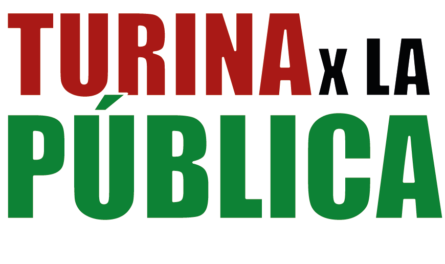

  

<h1 align="center">Turina Organizado</h1>

<strong>La web de la organización estudiantil del IES Joaquín Turina</strong>

## Sobre el proyecto

**Turina Organizado (Turina xLa Pública)** es una iniciativa de organización estudiantil que defiende la educación pública y la participación del alumnado. Esta web reúne noticias, convocatorias, eventos, el programa de la asamblea y formas de implicarse.

## Cómo está hecha

Es una web estática desarrollada con [Hugo](https://gohugo.io/), a partir del tema [Popular](https://popular.mariatta.ca/) y personalizaciones propias. No utilizamos una base de datos ni servidor de aplicaciones.

- **`content/`** — páginas, artículos y eventos en Markdown.
- **`layouts/`** — plantillas y componentes de Hugo.
- **`assets/`** — CSS, variables de diseño y JavaScript.
- **`static/`** — imágenes, logotipo, iconos y tipografías.
- **`hugo.toml`** — configuración del sitio.

## Cómo contribuir

¡Se agradecen las correcciones, ideas y mejoras! Puedes [abrir una incidencia](https://github.com/AverageRoi/Turina-Organizado/issues) para informar de un error o proponer una función, o [enviar un pull request](https://github.com/AverageRoi/Turina-Organizado/pulls) (PR) con los cambios. Describe brevemente lo que has hecho y, si afecta al diseño, incluye capturas. Intenta comprobar y testear los cambios realizados antes de crear una PR.

Procura mantener los cambios accesibles, adaptados a móvil y coherentes con el estilo existente. Trabaja sólo sobre los archivos fuente, **`public/` es contenido generado** automáticamente y **no debe editarse** directamente.

Basado en el tema Popular de Mariatta, distribuido bajo licencia MIT (véase <a href="LICENSE.popular">LICENSE.popular</a>).
